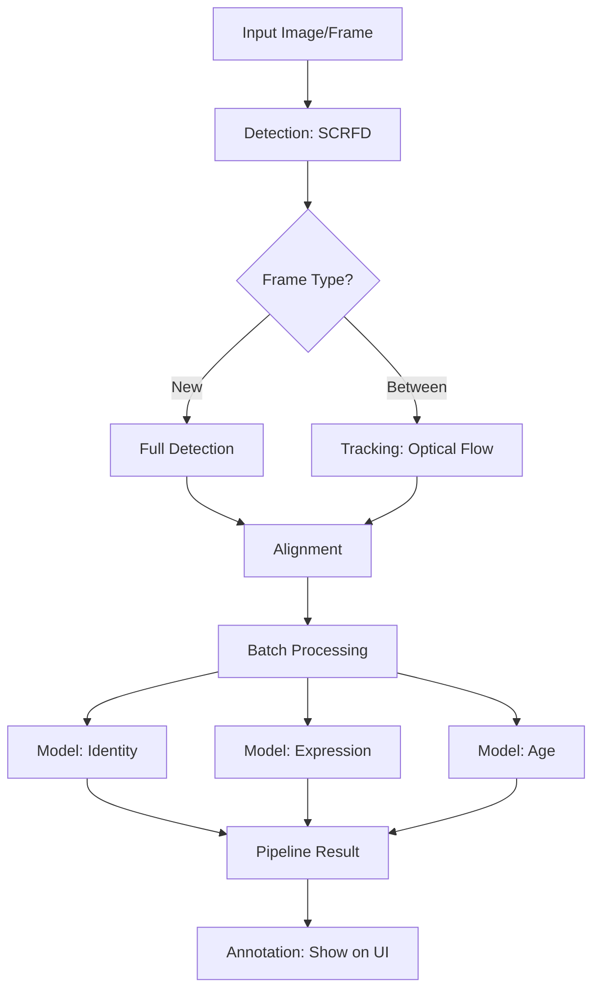

# Project Understanding: AI Face Intelligence System

Welcome! This guide is designed for someone who is completely new to this codebase. It breaks down what the project does, how it works, and how to talk about it technical terms.

---

## 1. What is this project?
This is a **Local-First Face Intelligence System**. 
- **"Local-First"**: All data (your faces, your processing) stays on your machine. Nothing is sent to a cloud server. 
- **"Intelligence"**: It doesn't just find faces; it understands them by answering four questions:
    1. **Detection**: Where is the face? (And align it perfectly)
    2. **Recognition**: Who is this person? (Based on a gallery you enroll)
    3. **Expression**: What is their emotion? (Happy, sad, neutral, etc.)
    4. **Age**: Roughly how old are they?

---

## 2. High-Level Workflow (The Pipeline)
Imagine the system processing a video frame:

1. **Input**: A frame comes from a webcam or a video file.
2. **Detection (The "Scout")**: 
   - Every few frames (set by `detection_interval`), the system uses a smart detector (**SCRFD**) to find faces.
   - For the frames *in between*, it uses **Tracking** (optical flow) to follow the face without re-scanning the whole image. This saves a massive amount of CPU power.
3. **Alignment**: It detects 5 specific points on the face (eyes, nose, mouth) and "warps" the face so it sits perfectly straight. This makes recognition much more accurate.
4. **Batching**: Instead of analyzing faces one by one, it stacks them into a single "batch." This allows the computer to process them simultaneously, which is much faster.
5. **The 4 Models**: The batch passes through 4 neural networks:
   - **ArcFace**: Recognizes the identity.
   - **HSEmotion**: Classifies the emotion.
   - **FairFace + GenderAge**: Estimates the age (with "honest uncertainty" – it tells you if it's not sure).
6. **Smoothing**: It uses a technique called **EMA (Exponential Moving Average)**. This prevents "flicker" (e.g., if one frame says "happy" and the next says "neutral" due to a blur, EMA smooths it out so it feels natural).

---

## 3. Project File Map
- `backend/app/`: The brain of the operation.
    - `api/`: The door to the system. `routes.py` handles API requests; `ws.py` handles the live webcam stream.
    - `core/`: The "Engine Room." Contains `onnx_runtime.py`, which runs the models using hardware acceleration (making it fast).
    - `services/`: The specialized workers.
        - `detection.py`: Finds faces.
        - `recognition.py`: Knows who they are.
        - `expressions.py`: Reads feelings.
        - `age_estimation.py`: Guesses age.
        - `tracking.py`: Keeps track of moving faces.
        - `pipeline.py`: The manager that ties all services together.
- `models/`: Where the neural network files (`.onnx`) live.
- `docs/`: Detailed deep dives on architecture and models.

---

## 4. Expected Technical Questions & Answers

**Q: Why use INT8 quantization?**
*A: It shrinks the model size by ~75% and makes it run much faster on CPUs with minimal loss in accuracy. It turns a heavy model into a "production-ready" lightweight one.*

**Q: Why use decoupling (Detection vs Tracking)?**
*A: Running a face detector on every single frame is overkill. Tracking allows us to find the face once and follow it cheaply, only calling the heavy detector when necessary.*

**Q: How does it handle "flicker" in emotion detection?**
*A: We use Temporal EMA (Exponential Moving Average). Instead of reacting instantly to one shaky frame, we blend the current result with previous results to keep the output stable.*

**Q: What is "Honest Uncertainty" in age estimation?**
*A: Instead of giving a fake-confident answer, we run two different models. If they disagree significantly, we report that disagreement as "uncertainty," letting the user know the estimate isn't solid.*

**Q: Why 5-Point Umeyama Alignment?**
*A: Faces in the wild are often tilted. Aligning them to a standard template (like the one used in training) significantly boosts recognition accuracy.*

---

## 5. Visual Flow Diagram

